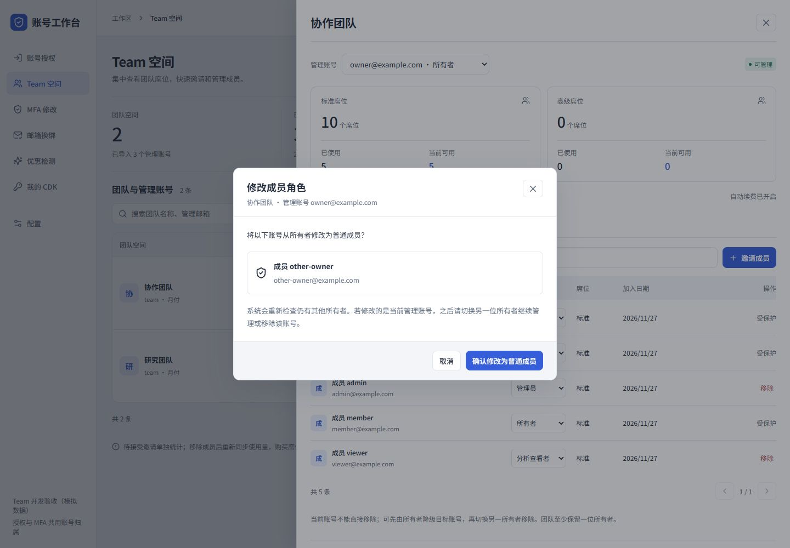

# Team 空间：CDK 权限、扣次与所有者交接

更新日期：2026-11-28。本页覆盖原设计中「Team 管理免费、首版不改角色」的约定。

## CDK 开关

管理员可以在「CDK 管理 → 生成 CDK」时勾选 **开放 Team 空间**，也可以在已有 CDK 的「详情」中设置并点击 **保存 Team 权限**。

普通 CDK 默认关闭，包括未配置过此权限的历史 CDK；管理员自己的工作区始终开放。管理员切换到普通 CDK 工作区时，仍按该工作区权限判断。

关闭时隐藏菜单，服务端拒绝全部 `/api/teams/` 请求和 Team 导入费用预览。开关保存在独立的 CDK 设置中，普通用户不能修改。权限撤销后，页面重新读取权限并离开已打开的 Team 页面，后台任务停止后续请求；已有团队数据与账号资料保留。

## 导入扣次

- 当前 CDK 首次入库的账号，每个扣 1 次 CDK。
- 同一批重复邮箱先去重；同一 CDK 已有账号的资料更新、重新登录和内部关联不重复扣次。
- Team 与账号授权共用入库清单：从已有授权选择不重复扣，Team 已收费账号进入账号授权时也不重复扣。
- 管理员自己的工作区沿用既有免扣次规则；管理员代管普通 CDK 时按该 CDK 余额扣次。
- 一个账号发现多个团队只按账号计一次，不按团队数量计费。团队成员的邀请、角色修改和移除不另扣导入次数。

导入预览显示当前可用、预计扣除和导入后剩余；确认导入时再使用通用费用确认弹窗。服务端统一串行处理导入、预留额度、保存账号与结算账单，客户端不能通过绕过弹窗免费入库。

余额不足不导入；取消费用确认不扣次。格式 / 摘要校验失败释放额度预留。成功入库后的登录失败或任务取消不自动退次，后续更新仍不重复收费。请求重试复用同一标识，不重复扣；服务重启可恢复已保存但尚未结算的导入。

历史 Team 账号不补扣过去的导入费用。已从团队移除的账号仍属于当前 CDK 的入库清单，防止移除后重新导入被误判成新账号。

「删除记录」清除本系统中的团队管理记录，并保留账号凭据与已收费身份；删除不退次数，重新导入恢复管理时也不重复扣次。该操作与移除真实团队成员分别提供，GPT 团队、成员和订阅保持不变。详见 [实现说明：删除管理记录](./implementation.md#删除管理记录)。

## 账号1交接给账号2

1. 使用账号1管理团队，邀请账号2。
2. 账号2接受邀请，成为现有成员。待接受邀请不能直接修改角色。
3. 账号1在「现有成员」中，将账号2的角色改为 **所有者** 并确认。
4. 把账号1改为 **普通成员**。可由仍是所有者的账号1修改自己，也可切换账号2后修改账号1。
5. 导入或关联账号2，切换抽屉中的 **管理账号** 为账号2。角色变化后的账号会自动重新同步，确认最新管理权限。
6. 使用账号2移除已是普通成员的账号1。

邀请弹窗已开放角色下拉选择，所有者也可直接将账号2作为所有者邀请；账号2接受后即可按实际权限继续交接。邀请和角色修改完成后，系统自动核对最新成员与待接受邀请，并同步刷新关联管理账号的权限，通常无需手动点击「重新识别」。上游查询短暂滞后时会自动重读和排队同步，持续失败时显示同步错误而不重复提交写操作。

每次角色修改都显示目标团队、目标邮箱、当前角色和新角色，确认后重新读取成员数据再提交。系统阻止将最后一位所有者降级；自己不能用当前会话直接移除自己；仍是所有者的账号需先降级才可移除。管理员和普通成员不能发起所有者变更，目录管理成员也不开放角色修改。

修改当前账号的角色后立即收回相应管理能力。移除账号1时只移除它与当前团队的关联，账号1的凭据、已收费记录及其他团队保留；账号2与团队记录继续保留。

## 接口与验证

新增角色接口：`POST /api/teams/{id}/role`，请求字段为 `accountId`、`memberId`、`memberEmail`、`previousRole`、`role` 和 `requestKey`。支持 `role: account-owner` 或 `role: standard-user`。

上游使用 HAR 中观察到的 `PATCH /backend-api/accounts/{workspace_id}/users/{user_id}`，请求体为 `{ "role": "…" }`。角色写入沿用已有团队操作锁和请求标识；结果不明时先同步确认，不盲目重复修改。

已通过：

- `npm run check:teams`：计费确认、余额不足、取消、重复导入、并发扣次、失败释放预留、重启恢复、CDK 开关与撤销、角色交接、最后一位所有者保护、角色响应丢失后查询确认。
- `test/team-ownership.mjs`：完整覆盖邀请账号2、模拟接受、提升账号2、账号1降级、切换管理账号、移除账号1及保留其他团队。
- `test/cdk-sms-permissions-ui.mjs`：CDK 生成与详情中的 Team 开关、菜单显示 / 撤销以及其他权限保持独立。
- `npm run check:cdk`、`npm run check:ui`、`npm run check:offers` 与前端构建。

验证使用本地模拟上游，未执行真实团队的邀请、角色变更或移除。

桌面浏览器另核对了新账号的扣次预览（7 次 → 扣 1 次 → 剩余 6 次）、取消费用确认，以及成员角色选择与确认弹窗。页面未观察到脚本错误。

