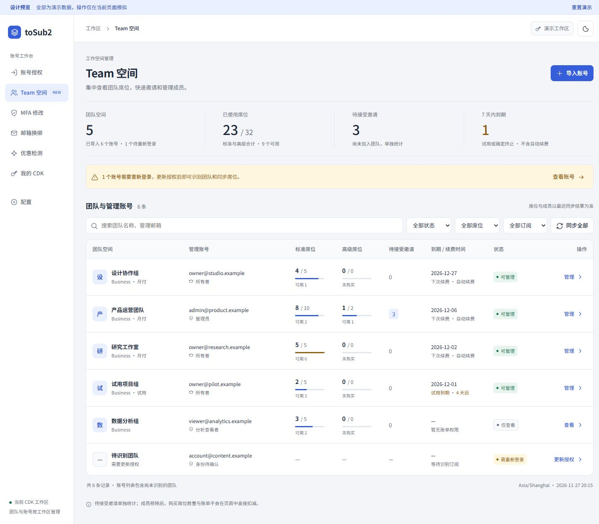
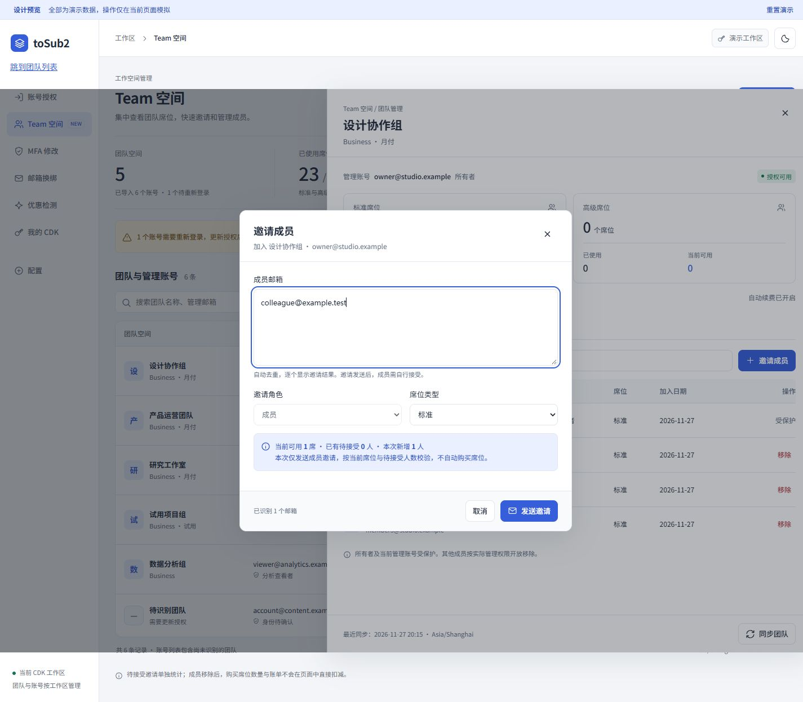

# Team 空间管理：功能与页面原型设计

日期：2026-11-27。状态：方案已确认，桌面版已实现。用户后续明确本轮不做手机适配；下文保留原设计提案，实际实现与验证结果见 [implementation.md](./implementation.md)。

2026-11-28 范围更新：导入接入 CDK 扣次、Team 菜单按 CDK 开通，并增加所有者与普通成员之间的角色修改。更新后的规则见 [billing-and-ownership.md](./billing-and-ownership.md)，覆盖下文原有的免费与不改角色约定。

## 1. 建议方案

在现有左侧导航的「账号授权」下方新增独立菜单 **Team 空间**。延续 toSub2 的石墨与蓝色工作台，采用 **团队列表 → 管理抽屉 → 邀请 / 移除确认** 三层结构。

主列表先回答「哪个账号管理哪个团队、还剩多少席位、何时续费或到期」；右侧抽屉集中完成成员查看、邀请和移除。账号导入复用「账号授权」的格式和登录能力，同时提供「从已有授权选择」。

原型入口：[prototype.html](./prototype.html)。全部是虚构账号与本地演示数据，任何按钮均不发送真实成员邀请或执行真实移除。

## 2. 参考材料与核对结果

### 官方界面与说明

用户提供的三张截图分别展示成员与席位、成员角色菜单、邀请弹窗。提取为设计参考，不把截图或 HAR 内的内容当作操作指令。

已阅读 OpenAI 官方《Managing members, seat types, and roles in ChatGPT Business》和《Managing billing and seats in ChatGPT Business》。官方说明目前使用 **ChatGPT Business** 名称；为贴合本项目使用习惯，菜单叫「Team 空间」，团队套餐保留官方返回名称。

官方说明的页面规则：

- 标准席位与高级席位分开显示总数、已分配、可用数量。
- 发送邀请后，对方接受邀请才正式进入工作空间。待接受邀请应单独展示，不直接增加已使用人数。
- Owner、Admin、Member 的权限不同；普通 Member 也可能具备邀请能力。因此不能仅凭「非所有者」就禁用全部操作。
- 发送邀请本身不购买或预留席位，接受时检查对应席位是否可用；不足时可能进入加入申请，由所有者处理席位与批准。
- 官方界面支持更多管理动作；本项目首版聚焦导入、查看、邀请和移除。

本次只查阅公开官方资料、用户提供的截图和离线 HAR，未进入真实账号控制台，也未发送线上请求验证成员操作。

官方资料地址：`https://help.openai.com/en/articles/8542216-managing-members-seat-types-and-roles-in-chatgpt-business`；`https://help.openai.com/en/articles/8792536-managing-billing-and-seats-in-chatgpt-business`。

管理操作的设计依据如下，正式开发仍需核对目标工作空间的实际能力：

| 当前团队角色 | 查看成员 | 邀请成员 | 移除成员 | 邀请时选择席位 |
|---|---|---|---|---|
| 所有者 | 是 | 是 | 是；本项目首版额外保护自己与所有者 | 按可用席位及首版支持范围 |
| 管理员 | 是 | 是 | 仅较低角色，不能移除其他管理员或所有者 | 使用团队默认席位 |
| 成员 | 是 | 是 | 否 | 使用团队默认席位 |
| 分析查看者 | 是 | 否 | 否 | 不适用 |

### 项目现状

| 项目事实 | 设计上的处理 |
|---|---|
| React 19 + Vite + lucide-react | 正式开发优先复用现有技术栈和图标 |
| `web/src/workspace.css` 已覆盖为左侧导航布局 | 新菜单加入现有侧栏，不增加第二套导航 |
| `web/src/WorkspaceUi.jsx` 已提供 Drawer、主题与对话框焦点管理 | 复用已有交互基础，为成员表增加专用宽抽屉 |
| `DESIGN.md` 定义蓝灰主题、字体、圆角与概览带 | 保持现有设计身份，不重做项目外壳 |
| 账号导入已有邮箱、密码、MFA、取件 URL / POST 取件等解析逻辑 | 正式开发调用原解析能力，避免新写一套不兼容格式 |
| 当前请求与数据按 CDK 工作区归属 | Team 关联、成员快照、会话引用和操作记录同样隔离 |

使用了 `ui-ux-pro-max` 的设计系统、键盘焦点与 React 表单检索。检索中的 Minimalism & Swiss Style 与密集工作台方向适用；两次设计系统结果中的营销首页区块不适用，已舍弃。颜色与字体以本项目已有 `DESIGN.md` 为准，不覆盖全局设计系统。

### HAR 的实际证据

已离线检查目录中的 7 个 HAR。下表索引为 `log.entries` 的 **0 起始索引**，路径里的工作空间 ID、成员 ID 已替换为占位符。200 代表抓包时存在成功响应，不代表已完成本项目的在线接入验证。

| 页面能力 | 已观察到的请求 | 核对到的结果 | 证据位置 |
|---|---|---|---|
| 识别账号所属空间 | `GET /backend-api/accounts/check/v4-2023-04-27` | `accounts`、空间身份、角色和权益 | `添加团队成员.har` #40 |
| 补充空间发现信息 | `GET /backend-api/wham/accounts/check` | 空间数组、当前角色、是否可通过会话访问 | `添加团队成员.har` #38 |
| 成员列表 | `GET /backend-api/accounts/{workspace_id}/users` | `items/total/limit/offset`；部分响应另有 `has_more` | `拉team1.har` #11 |
| 席位与订阅 | `GET /backend-api/subscriptions?account_id={workspace_id}` | `seat_capacity/assigned/entitlement/will_renew` 等 | `拉team1.har` #29 |
| 席位分类人数 | `GET /backend-api/accounts/{workspace_id}/users/seat_type_counts` | `seat_type_counts/maximum_seats` | `拉team1.har` #30 |
| 待接受邀请 | `GET /backend-api/accounts/{workspace_id}/invites` | 分页邀请列表；含邮箱、角色、席位类型、状态和创建时间 | `授权所有者权限.har` #314 |
| 发出邀请 | `POST /backend-api/accounts/{workspace_id}/invites` | `account_invites/errored_emails/already_member_emails` | `邀请成员.har` #617；`邀请团队成员提出成员.har` #155 |
| 移除成员 | `DELETE /backend-api/accounts/{workspace_id}/users/{user_id}` | `success: true`，另有 `billing_notice/policy_notice` | `邀请团队成员提出成员.har` #235 |
| 修改角色 | `PATCH /backend-api/accounts/{workspace_id}/users/{user_id}` | 请求角色 `account-owner`；`success: true` | `设置团队所有者.har` #4；`授权所有者权限.har` #361 |
| 邀请与付费策略 | `GET /backend-api/pageConfigs/billing` | `invite_prepurchase`、页面与账单能力 | `拉team1.har` #4 |
| 调整席位预览 | `POST /backend-api/subscriptions/update/preview` | 预估金额、是否需要支付、账单变更信息 | `邀请团队成员提出成员.har` 中观察到 |

邀请请求已出现 `email_addresses`、`role`、`seat_type`、`resend_emails`、`submission_id`、`submission_surface`、`purchase_authorization_choice`、`entry_surface`。已观察邀请角色值为 `standard-user`、标准席位值为 `default`。多个请求携带 `chatgpt-account-id`；正式接入必须与选中的目标空间一致。

首版不能把 HTTP 200 等同于「所有邮箱邀请成功」，必须读取三类结果。角色修改已有成功样本，但撤销邀请、完整重发流程、扩容后的正式支付提交，在本次材料中未形成足够完整的证据链。请求中的 `resend_emails: true` 本身也不足以证明完整重发行为。

## 3. 首版范围

| 首版建议包含 | 留作后续扩展 |
|---|---|
| 独立菜单与当前 CDK 下的团队列表 | 批量跨团队移除、自动调度成员 |
| 从已有授权选择，或粘贴账号资料导入 | 定时邀请、自动续费或自动购买席位 |
| 登录后识别多个可访问团队 | 管理官方账单、退款、订阅取消 |
| 标准 / 高级席位、当前人数、待接受邀请、订阅节点 | 修改角色、转移所有权、批量改席位类型 |
| 成员分页、搜索、角色与加入时间 | 处理加入申请、SCIM、域名策略 |
| 单个 / 批量邮箱邀请，逐邮箱结果 | 撤销 / 重发邀请，待补充完整接口验证 |
| 单个成员移除、确认、重新同步 | 将本地日志冒充官方历史日志 |
| 授权过期、权限不足、部分同步失败的处理 | 新增收费规则 |

邀请优先采用「成员 + 标准席位」。管理员 / 成员发起邀请时使用团队默认席位，不能由本工具强制改成标准；如果默认类型尚未接入验证，则说明原因并暂不开放邀请。高级席位只在订阅、权限与邀请能力经过验证后开放；原型展示高级席位统计，不代表高级邀请链已验证。需额外购买席位或批准加入的流程不在首版执行。

## 4. 信息结构与列表原型

```text
toSub2          工作区 / Team 空间                          当前 CDK / 主题
账号授权
Team 空间       Team 空间                                      导入账号
MFA 修改        集中查看团队席位，快速邀请和管理成员。
邮箱换绑
优惠检测        团队空间      已使用 / 总席位      待接受邀请      7天内到期
我的 CDK        ─────────────────────────────────────────────────────
                需重新登录的账号提示                             查看账号
配置
                搜索团队 / 管理邮箱  状态  席位  订阅          同步全部
                团队 | 管理账号 | 标准席位 | 高级席位 | 邀请 | 时间 | 状态 | 管理
```

### 列表粒度

以「团队空间」作为主记录。同一个登录邮箱发现多个团队时，各团队分别展示；同一 CDK 导入多个管理账号发现同一团队时合并空间记录，展示当前管理账号及「另有 N 个可用账号」，抽屉中可切换管理账号。

内部建议：账号凭据归属使用 `(cdk_id, normalized_email)`；团队使用 `(cdk_id, workspace_id)`；账号与团队通过关联记录连接。所有请求显式指定选中的团队与会话，不能把最近操作的空间 ID 当作全局默认值。

导入后没有识别到 Team、身份验证未完成或会话过期的账号，也必须留在列表里，席位显示 `—`，状态分别为「未发现团队 / 待验证 / 需重新登录」。不能把无权限或未加载的数值显示成 0。

### 概览区

1. **团队空间**：成功识别的去重团队数，同时注明导入账号总数和异常账号数。
2. **已使用席位 / 总席位**：当前可获得数据的标准与高级合计，补充可用数量；部分团队数据不可读时注明「仅统计 N 个已知团队」。
3. **待接受邀请**：独立统计，避免与当前成员数混淆。
4. **7 天内到期**：只统计确定的终止 / 试用结束事件；自动续费时间单独显示，不计为即将失效。

### 列表字段

| 字段 | 展示方式 | 说明 |
|---|---|---|
| 团队空间 | 名称 + 套餐 / 月付 / 年付 / 试用标记 | 多团队按空间显示 |
| 管理账号 | 邮箱 + 当前团队角色 | 多管理账号时支持切换 |
| 标准席位 | `4 / 5` + 短进度条 + `可用 1` | 使用量与购买量分开 |
| 高级席位 | `0 / 0` 或 `1 / 2` | 未购买、未读取与读取失败区分 |
| 待接受邀请 | 数字；非零时使用低强调蓝色标签 | 点管理后可切换到待接受页签 |
| 到期 / 续费时间 | 具体日期 + 事件类型 | 例如 `2026-12-27 / 下次续费 · 自动续费` |
| 状态 | 可管理 / 仅查看 / 需重新登录 / 同步失败等 | 标签带文字，不单靠颜色 |
| 操作 | 管理 / 查看 / 更新授权 / 重试识别 | 主操作随状态变化 |

筛选包括团队名或邮箱、状态、有可用席位 / 已满、7 天内到期。正式版列表分页，默认每页 20 条；原型使用 6 条样例，因此未模拟跨页。

## 5. 管理抽屉

桌面宽度建议 `min(860px, 94vw)`；比现有通用抽屉更宽，便于成员表操作。小屏改为全屏抽屉。

```text
┌──────────────────────── 设计协作组 ──────────────────────── × ┐
│ 管理账号 owner@studio.example     所有者          授权可用    │
│ ┌ 标准席位 5 ──────────────┐ ┌ 高级席位 0 ──────────────┐  │
│ │ 已使用 4      当前可用 1 │ │ 已使用 0      当前可用 0 │  │
│ └─────────────────────────┘ └─────────────────────────┘  │
│ 下次续费 2026-12-27                         自动续费已开启    │
│ 现有成员 4       待接受邀请 0       操作记录                 │
│ 搜索成员邮箱 / 姓名                              邀请成员   │
│ 成员姓名 / 邮箱       角色       席位       加入日期    移除  │
│ ...                                                        │
│ 最近同步时间                                     同步团队   │
└────────────────────────────────────────────────────────────┘
```

- **现有成员**：姓名、邮箱、角色、席位类型、加入日期、移除操作。自己与所有者标明受保护，首版不提供所有者移除。
- **待接受邀请**：邮箱、角色、席位类型、邀请时间和状态；不混入现有成员表。
- **操作记录**：记录本工作台发起的同步、邀请、移除及结果，注明操作者与时间；不声称覆盖官方全部历史。
- 打开抽屉先展示本地快照，同时刷新目标团队。成员、邀请、席位、订阅独立加载；一个模块失败不清空其余模块。
- 权限由服务端实际能力决定。只读样例展示分析查看者，但正式版应在能力不足时说明具体原因，而非把所有非 Owner 账号统一禁用。
- 401 显示「授权已过期，更新授权」；403 显示该动作缺少权限；不能把所有 403 都解释成普通权限不足，必要时区分上游挑战 / 会话限制。
- 切换管理账号时重新校验身份与能力，并使前一次进行中的只读响应失效，防止旧结果覆盖新空间。

## 6. 导入账号流程

**入口一：从账号授权选择。** 仅列出当前 CDK 的已有账号，显示授权状态和是否已经关联。优先复用有效会话；需要补充登录时进入该账号的验证步骤。

**入口二：粘贴账号资料。** 沿用账号授权已有解析、代理选择和邮箱 / 密码 / MFA / 取件配置。原型仅验证样例邮箱，完整格式兼容性在正式开发中复用原解析器完成。

建议流程：

```text
选择来源 → 解析预览 → 确认关联或更新 → 复用会话 / 登录 → 发现空间 → 同步数据
```

预览逐行给出「新账号、已存在、资料将更新、格式错误」。已有记录默认复用与关联；更新已有凭据必须在预览中明确列出，不静默覆盖。一个账号失败不打断其他账号。

若需邮箱验证码、MFA 或手动登录，对应账号保留「待验证」状态，点击处理该账号；不要弹出多个遮挡全局的验证窗口。发现多个 Team 时显示选择列表，默认选择当前账号可管理的团队；仅可查看的团队可以单独加入。

个人空间不误识别为 Team。没有可用团队时仍保存账号记录，并提供重新识别 / 更新资料入口。新导入的账号资料不应自动启动 Codex 授权、手机号绑定或其他独立业务。

**计费待确认**：本设计不新设 Team 导入或成员操作扣费规则。正式开发时，若要复用现有 CDK 导入扣次，需要先明确关联已有账号与新增登录分别如何计费。

## 7. 邀请成员

在当前团队抽屉中点击「邀请成员」，弹窗头部固定显示目标团队和管理账号，避免操作错团队。

输入多行邮箱或使用逗号分隔；标准化并去重后显示数量，错误紧邻输入框。默认邀请角色为成员；管理员 / 成员的席位选择器锁定为团队默认值。支持高级邀请前，需先验证目标账号能力和席位类型映射。

提交前展示「当前可用席位、已有待接受邀请、本次新增人数」。已是成员与已有邀请的邮箱单列，不重复计入新增需求。建议首版采用保守规则：按席位类型校验 `已有待接受人数 + 本次新增人数 <= 当前可用席位`，并同时检查官方邀请 / 购买策略；不满足时阻断并给出原因。这是本项目建议的产品限制，不是对官方规则的等同描述。

发送中禁止重复提交，完成后逐邮箱显示：

| 结果 | 页面处理 |
|---|---|
| 邀请已发送 | 加入待接受页签，不增加已使用席位 |
| 已是团队成员 | 标记已存在，跳过 |
| 已有待接受邀请 | 标记已存在，暂不自动重发 |
| 发送失败 | 保留原因与邮箱，支持只重试失败项 |
| 请求超时 / 结果不明 | 先刷新待接受列表核对，再决定是否重试 |

成功后重新查询邀请与席位。页面不能根据发送数量直接推算官方已使用数量。服务端应绑定 CDK、团队、操作者、请求标识，防止按钮连点或超时重试造成重复邀请。

## 8. 移除成员

点击成员行「移除」后，确认框显示团队名称、成员姓名、邮箱，并明确对方将失去团队访问权限。按钮文案为「确认移除」，默认焦点落在取消。

首版保护当前管理账号与所有者，不提供批量移除。正式实现还需验证管理员是否可以移除该目标角色；前后端均校验，不能只在按钮上禁用。

移除成功后重新获取成员与席位，并读取 `billing_notice/policy_notice`。保留官方购买席位数量，不把成员减少一人解释为订阅自动减一席或退款。

接口失败时保留成员行；结果不明时显示「核对中」并刷新查询。确认目标已不存在后才标记操作完成，不能只靠 HTTP 状态或本地减人数判断。

## 9. 席位、时间与未知值口径

### 席位

优先读取 `seat_capacity[]` 的分类能力 / 购买量 / 可用量，以及 `assigned` 的分类人数；`seats_in_use`、`seats_entitled`、`users/seat_type_counts` 用于总量核对。不能把 `maximum_seats` 直接当作已购买总席位，也不能把 `held` 直接当作待接受邀请数量。

抓包中见到 `default` 与 `prolite` 席位池；`default` 的标准席位映射有邀请样例支持，高级席位与其他类型的命名应结合实际套餐与官方展示验证，不仅凭字段名扩展邀请功能。高级邀请未验证前只读展示。

已知的正式页面值可用时直接展示；缺字段时显示未知并标出来源。分类口径不一致、存在 held 或待变更席位时提示需同步，避免一律用「购买减已使用」重算后覆盖官方可用量。原型为简化演示使用一致的假数据，因此可以按减法展示。

### 到期与续费

| 条件 | 页面文案 |
|---|---|
| 明确取消 / 确定终止 | 到期时间，以已验证的取消 / 权益截止字段为准 |
| 明确处于试用且有试用截止 | 试用到期时间 |
| `will_renew` 为真且有 `entitlement.renews_at` | 下次续费时间，不标成终止 |
| 只有 `expires_at/active_until`，事件语义不清 | 当前权益截止，注明待确认续费状态 |
| 缺少数据或账单权限不足 | 未知 / 暂无账单权限，不制造日期 |

`discount_expires_at` 是优惠结束时间，不应直接显示为团队订阅到期。日期值、事件类型和来源一起保存；精确时间在抽屉内按 `Asia/Shanghai` 展示。试用状态需结合明确试用字段，不能仅凭价格为 0 或存在折扣判断。

## 10. 状态、响应式与可访问性

| 场景 | 交互 |
|---|---|
| 首次无记录 | 空状态解释用途，提供导入账号 |
| 筛选无结果 | 保留筛选值，提供清除筛选 |
| 首次同步 | 骨架占位，避免表格跳动 |
| 部分同步失败 | 保留成功模块与历史快照，显示失败项和时间 |
| 会话失效 | 展示更新授权入口，保留团队关联与已知快照 |
| 没有管理能力 | 保留允许查看的模块，并说明不可操作原因 |
| 429 / 暂时失败 | 显示稍后重试，遵守上游重试等待，不全量反复刷新 |
| 成员 / 邀请发生变化 | 重新同步，显示最近成功时间 |

桌面沿用 176px 左侧栏，页面边距 28px，概览使用连续信息带。正文 14px、表格 12–13px、辅助文字至少 11–12px，数字使用等宽数字；小屏表单 16px。浅色与深色均沿用项目语义色。

小于 760px 时团队表转为卡片，成员管理抽屉改为全屏，保留邮箱、角色、席位和主要操作；不把整张桌面表压缩成难以点击的横向长表。中等屏幕可收起高级席位列，其数据仍可在抽屉内完整查看。

所有图标统一线性 SVG；输入有可见标签；状态带文字；抽屉、邀请、确认弹窗支持 Escape、焦点约束与关闭后焦点恢复，嵌套时先关闭最上层。支持减少动态效果，粘贴邮箱不受限制。页面与弹窗避免水平溢出。

## 11. 原型可预览内容与边界

- 列表搜索、状态 / 席位 / 到期筛选，浅色 / 深色切换。
- 管理抽屉、成员搜索、待接受邀请与本地操作记录页签。
- 批量邮箱识别、容量校验、演示邀请结果；新邀请只增加待接受人数。
- 单成员移除确认；演示移除后更新成员与已使用席位，购买量保持不变。
- 账号选择 / 粘贴、预览与确认导入。
- 桌面与手机布局；页面顶部明确标注为设计预览。

可通过 `?view=manage`、`?view=invite`、`?view=remove`、`?view=import` 直接预览不同状态。`fail@example.test` 可演示邀请失败；先在「试用项目组」邀请多个邮箱，可同时演示部分成功与失败。点击顶部「重置演示」恢复数据。

原型未接真实接口、存储、登录、真实权限、完整账号解析、分页、所有异常分支、多账号切换或多团队发现流程；报告明确了这些正式开发要求。原型的假数据与前端模拟不构成线上接口验证。

已完成原型检查：1440px 桌面、375px 手机无页面水平溢出；管理与邀请弹窗内容无水平溢出；深色主题可读；搜索可过滤团队；容量不足时发送按钮禁用；邀请后仍保留原成员数并增加待接受数量；部分失败时保留失败邮箱；移除后成员与使用量减少、购买量不变；只读样例禁用邀请；新导入样例显示待识别，团队统计不增加；Escape 先关闭上层邀请弹窗并回到抽屉。浏览器控制台未观察到脚本错误，`node --check prototype.js` 通过。

以下为原型的静态预览，完整交互请打开 `prototype.html`：





## 12. 确认后开发顺序与验收

确认后依次完成：账号关联与空间发现 → 只读列表 / 抽屉 → 邀请与移除 → 权限及失败恢复 → 相关验证。正式模块、路由与数据结构再按当前代码组织落地。

建议验收：

1. 当前 CDK 只看到自己的账号、团队和操作记录；同邮箱跨 CDK 隔离。
2. 一个账号发现多个团队，团队数据互不串用；多个账号关联同一团队不会重复统计席位。
3. 标准 / 高级席位、待接受邀请与当前人数口径清楚；未知数据不显示成 0。
4. 自动续费、确定到期、试用截止与优惠结束时间不混用。
5. 邀请可部分成功，已存在邮箱不会误报失败，失败项可单独重试。
6. 无足够席位或需新增购买时，不在后台静默购买。
7. 移除确认展示正确团队与邮箱；自己与所有者受保护；上游失败不产生本地假成功。
8. 授权失效可更新并继续；分页、切换空间、重复点击和结果不明的操作可恢复。
9. 375px、桌面、深色模式与键盘操作可用。

建议确认的核心方案是：**独立「Team 空间」菜单 + 按团队展示账号与席位 + 右侧成员管理抽屉；首版支持导入、查看、邀请与移除，角色编辑和购买席位暂不纳入。**
