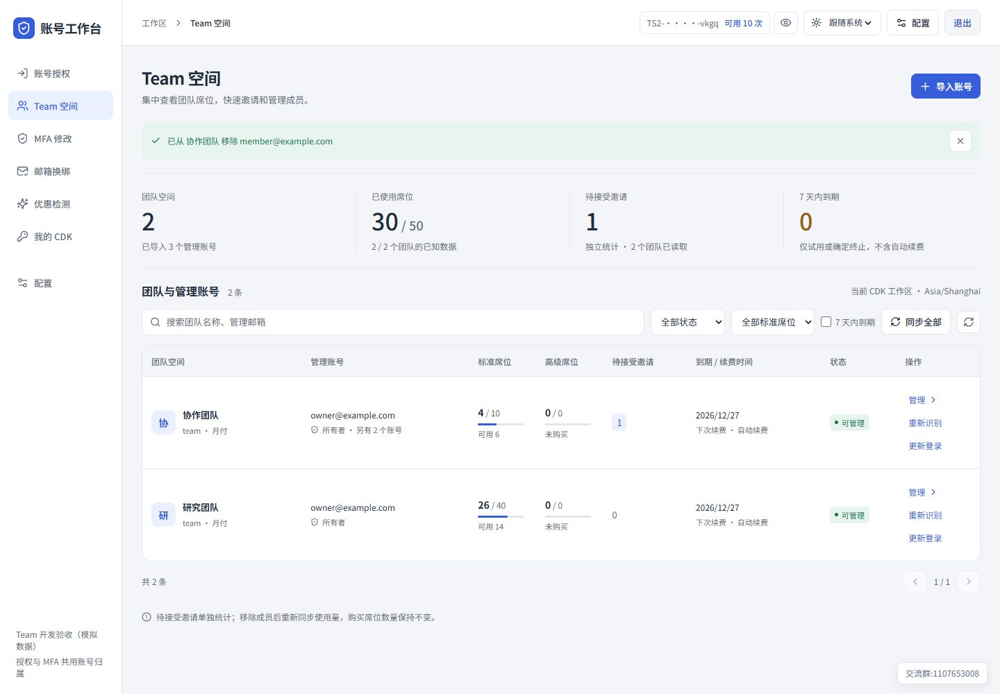
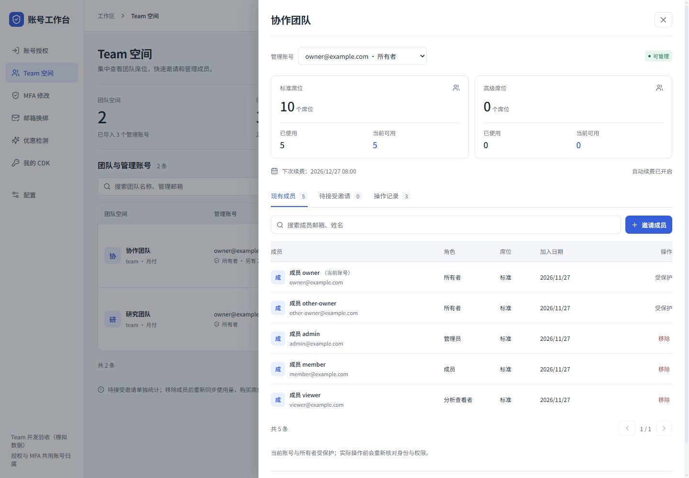

# Team 空间管理：实现与验收

首次实现：2026-11-27。更新：2026-11-28。桌面版本，不做手机适配。新增 CDK 扣次、菜单开关和所有者角色交接的使用方法见 [billing-and-ownership.md](./billing-and-ownership.md)。

## 已实现

- 左侧独立「Team 空间」菜单，沿用项目主题与 CDK 工作区。
- 从账号授权选择，或粘贴账号资料 / 会话 JSON 导入；导入前预览新账号、已有账号与资料更新。
- 已有账号默认复用凭据与代理；从授权选择时默认保留原代理。显式更新登录时重新执行 Web 登录，支持密码、MFA、邮箱验证码与取件 URL。
- 识别账号可访问的团队；一个账号可关联多个团队，同一 CDK 的多个管理账号可合并到同一团队，并在抽屉切换。
- 团队列表、搜索、状态 / 标准席位 / 7 天到期筛选、每页 20 条。
- 标准 / 高级席位的购买量、使用量与可用量；待接受邀请独立计数；区分到期、试用结束、续费与当前权益截止。
- 管理抽屉内的成员分页与搜索、待接受邀请、操作记录。
- 成员邮箱批量邀请，自动去重，跳过已是成员或已有邀请的邮箱；逐邮箱显示成功、失败或待核对结果。
- 单成员移除确认；保护当前管理账号与所有者，管理员只能移除较低角色；目录管理成员不开放移除。
- 授权过期、部分同步失败、历史快照、登录验证、停止任务与重启后的中断恢复。
- 邀请 / 移除请求标识与并发锁；结果不明时禁止直接重复写入，后续同步可以根据成员 / 邀请列表确认已完成结果。

## 首版约定

Team 导入接入统一账号入库计费：同一 CDK 的新账号每个扣 1 次，已有账号更新或内部关联不重复扣。普通 CDK 需由管理员单独开通 Team 菜单。原有接码计费逻辑保持不变。

邀请仅开放「成员 + 标准席位」。所有者可以将现有成员提升为所有者，也可以在仍有其他所有者时把原所有者降为普通成员；后续由另一管理账号移除。高级邀请、撤销 / 重发邀请与购买席位仍未纳入。

新增邀请必须满足：对应角色具备邀请能力、邀请策略已识别、成员 / 邀请 / 席位已完整同步，以及「已有待接受标准邀请 + 本次新增人数」不超过官方返回的标准可用席位。发送邀请不直接增加已使用人数。

成员移除后重新读取官方数据，购买席位数量不在本地直接扣减。官方返回存在账单 / 策略提示时，响应保留相应标志。

每批最多导入 100 个账号；每个 CDK 最多 500 个团队管理账号；每次邀请最多 50 个邮箱。查询官方集合时分页读取，单集合上限 5000 条，超过上限会停止并提示数据未确认。

## 主要文件

| 文件 | 作用 |
|---|---|
| `src/team-client.mjs` | 会话身份、官方接口、团队发现、席位 / 订阅标准化、权限能力与错误处理 |
| `src/team-workspace.mjs` | CDK 内账号与团队关联、加密凭据、任务调度、快照、邀请 / 移除与幂等记录 |
| `web/src/TeamWorkspace.jsx` | 桌面列表、抽屉、导入、验证、邀请与移除交互 |
| `web/src/teams.css` | 桌面样式；成员表单独定义最小宽度与列宽，避免继承全局 1740px 表格布局 |
| `src/console-server.mjs` | Team API、已有授权复用、账号互斥与全局调度接入 |
| `src/protocol-login.mjs` / `src/offer-runner.mjs` | 私有管道登录模式 `--team-login`，仅登录 Web 会话 |
| `test/team-*.mjs` | 本地模拟上游、工作区、HTTP、React 交互与桌面验收入口 |

持久化位置为所属 CDK 工作区的 `team-space/state.json`。会话与凭据使用绑定 CDK 和账号标识的加密作用域保存；公开 API 不返回令牌、密码、MFA 密钥或取件凭据。请求固定使用服务端配置的 ChatGPT 地址、选中的空间和该账号已保存的网络配置。

## API

接口均位于当前登录 CDK 的权限范围内，写操作沿用现有 CSRF 校验。

| 方法与路径 | 用途 |
|---|---|
| `GET /api/teams/state` | 默认列表与概览 |
| `POST /api/teams/query` | 搜索、筛选与分页 |
| `GET /api/teams/sources` | 当前 CDK 的账号授权来源 |
| `POST /api/teams/import/preview` | 导入预览与内容摘要 |
| `POST /api/teams/import` | 确认导入，要求预览摘要与请求标识 |
| `POST /api/teams/sync` | 排队同步所选 / 全部账号 |
| `POST /api/teams/delete` | 删除本工作区的团队 / 未识别账号记录，请求为 `{kind: "team" 或 "account", id}` |
| `POST /api/teams/accounts/{id}/login` | 明确发起重新登录 |
| `POST /api/teams/accounts/{id}/input` | 密码 / MFA / 邮箱验证码输入，支持邮箱码重发 |
| `POST /api/teams/accounts/{id}/cancel` | 停止账号任务 |
| `POST /api/teams/{id}/query` | 管理抽屉成员 / 邀请页 |
| `POST /api/teams/{id}/select-account` | 切换团队管理账号 |
| `POST /api/teams/{id}/invite-preview` | 去重结果、预计新增人数与容量校验 |
| `POST /api/teams/{id}/invite` | 邀请成员，要求请求标识 |
| `POST /api/teams/{id}/remove` | 移除成员，要求成员 ID、确认邮箱与请求标识 |
| `POST /api/teams/{id}/role` | 修改为所有者或普通成员，要求原角色、成员 ID、确认邮箱与请求标识 |

## 删除管理记录

团队列表的操作列和管理抽屉底部提供 **删除记录**。未识别到团队、同步失败或登录过期的独立账号行也可删除。确认弹窗列明目标团队 / 账号与影响范围，默认聚焦「取消」，成功后关闭对应抽屉并刷新列表、概览与分页。

删除仅作用于当前 CDK 的本地管理记录：清除团队成员快照、邀请缓存、订阅快照和操作记录，保留管理账号的加密凭据、账号授权记录与已扣次身份。账号仍管理其他团队时保留其他团队；没有其余团队关联的账号从管理列表和同步全部的范围中隐藏。

此操作不向 GPT 提交退出团队、解散团队、取消订阅或移除成员请求。已删除团队会被本地同步跳过，服务重启后仍保持删除状态；再次主动导入有权访问该团队的管理账号可恢复管理，已有账号不重复扣次，也不退还原导入次数。普通重新识别、更新登录，以及旧导入请求的重放均不会恢复已删除团队。删除前已排队的其他账号导入也不会把刚删除的团队重新添加。

正在登录、同步、邀请、修改角色或移除成员时禁用相关删除入口，服务端同步校验操作锁与所有关联账号的任务状态。接口沿用 Team 功能权限、CSRF 与 CDK 隔离校验。

记录删除已通过 `npm run check:teams` 和 `npm run build`。隔离桌面页面在 1440px 验证了列表入口、确认取消、抽屉删除后自动关闭、列表与概览刷新，未观察到页面脚本错误。验证使用临时工作区和本地模拟上游。

## 验证结果

`npm run check:teams` 通过，覆盖：

- 身份不符 / 过期、CDK 隔离、凭据加密与公开响应脱敏。
- 官方分页被限流为较小页长时仍完整读取；本地成员分页与搜索。
- 多账号合并同一团队、管理权限与默认席位限制。
- 邀请部分成功、重复请求不重复执行、未知结果经同步确认。
- 成员移除前确认、自己与所有者保护、移除后使用量变化而购买量不变。
- 部分查询失败保留历史数据、服务重启恢复。
- 任务中途登出不能恢复已失效的会话。
- 使用真实协议代码对本地模拟服务完成密码登录、手动邮箱验证码、取件 URL 自动收码；Team 专项角色测试单独验证所有者交接，不发起 Codex、手机号或账单变更。
- React 页面导入预览、成员抽屉、邮箱去重、邀请结果、移除确认与嵌套弹窗 Escape / 焦点。
- 本地记录删除、操作忙碌保护、其他团队与凭据保留、重启与同步不恢复已删除团队、显式重新导入免重复扣次，以及删除确认取消与抽屉关闭。

另已通过 `npm run build`、`npm run check:offers`、`npm run check:ui`、`npm run check:cdk`、`npm run check:proxy-pool`，以及单独执行的工作区存储、凭据存储、控制台恢复与优雅关闭检查。

MFA 会话、工作区、协议轮换、凭据加密、控制台与 UI 检查均通过；完整 MFA 命令在既有设备登出检查处存在间歇 409。两项既有回归问题已使用修改前的源码确认：

| 既有检查 | 观察结果与基线确认 |
|---|---|
| `test/lazy-credentials.mjs` | 初始化读取未提供的 `options.storage.call` 失败；使用 `HEAD` 的原始 `cdk-server.mjs` 仍在同一位置失败 |
| `test/device-logout-console.mjs` | 批次结束边界有时返回「请等待当前批次结束后再登出设备」409；原始 console / CDK / 协议 / runner 源码的独立副本也复现。单独执行曾通过，完整命令不能记为全通过 |

构建保留现有主包体积提示。未为本次功能更改上述存储接口或设备登出批次逻辑。

桌面浏览器使用隔离工作区和本地模拟上游完成了列表、管理账号切换、只读权限、批量邀请部分失败、移除确认、深色主题与 1440px 列宽检查；页面脚本错误为 0。当前抽屉内容宽度与可见宽度一致，无横向溢出。

以上均为本地测试和模拟数据，尚未使用真实团队验证邀请 / 移除，也未提交、推送或部署。

## 运行

常规运行继续使用 `npm start`。需要独立桌面验收时运行 `node test/team-preview.mjs`，该脚本创建临时工作区、模拟上游和测试 CDK，并输出本地地址；不连接真实团队。
